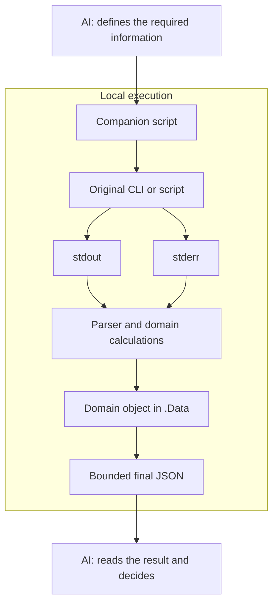
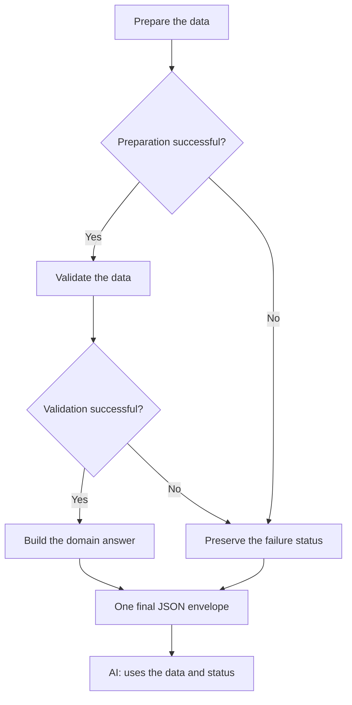

# CLI Companion Prompt — reduce the tokens read by AI

**Ask your AI agent to turn command output into useful answers using scripts it builds and runs locally.**

[SKILL](skills/quiet-cli/SKILL.md) contains the instructions to give the agent. For each CLI invocation, it asks the agent to prepare or reuse a **companion script** in **PowerShell Core 7.4+** or **Bash**. This script runs the intended command, consumes its output, and returns a common result object with a **freely defined `.Data` property**.

The AI reads the compact execution result. Local code handles logs, progress, and intermediate data.

## What is this prompt for?

Terminal output often mixes progress messages, repetition, diagnostics, and useful facts. When the agent reads all of this text, that volume enters its context.

The companion script turns repetitive interpretation into code: parsing a machine-readable format, counting events, selecting errors, normalizing fields, and computing the required answer.

This approach suits agents that inspect repositories, run builds or tests, process files, or chain several tools together. It is especially useful when output is verbose or data from several commands can be combined locally.

## Download a complete bundle

The [QuietCli ZIP](https://github.com/FrenchExDev/FrenchExDev/raw/refs/heads/develop/PoSh/FrenchExDev/FrenchExDev.QuietCli.PoSh/downloads/QuietCli.zip) contains the runtime, skill, examples, fixtures and verification launcher. It extracts into one `QuietCli/` directory. Use PowerShell **7.4+ Core** and Git for this first example; Python is needed only for the noisy-job example.

```powershell
$archive = Join-Path (Get-Location).Path 'QuietCli.zip'
Invoke-WebRequest -Uri 'https://github.com/FrenchExDev/FrenchExDev/raw/refs/heads/develop/PoSh/FrenchExDev/FrenchExDev.QuietCli.PoSh/downloads/QuietCli.zip' -OutFile $archive
Expand-Archive -LiteralPath $archive -DestinationPath (Get-Location).Path
$moduleRoot = Join-Path (Get-Location).Path 'QuietCli'
Import-Module (Join-Path $moduleRoot 'QuietCli.PoSh.psd1') -ErrorAction Stop
& (Join-Path $moduleRoot 'examples/Generated-GitOverview.ps1') `
    -Repository 'C:/code/my-project' -MaxOutputBytes 2048
```

Replace the repository path with yours. No PowerShell profile edit or editor installation is needed for this route. Give [SKILL.md](skills/quiet-cli/SKILL.md) and the extracted module path to your agent. Downloading that instruction file alone does not install the runtime.

The [archive manifest](https://github.com/FrenchExDev/FrenchExDev/blob/develop/PoSh/FrenchExDev/FrenchExDev.QuietCli.PoSh/downloads/QuietCli.manifest.json) records SHA-256 hashes and the source branch. GitHub links target the moving `develop` branch; keep the manifest with a downloaded archive to identify its contents. To reproduce the executable checks with an installed Python interpreter, run:

```powershell
& (Join-Path $moduleRoot 'scripts/Invoke-Examples.ps1') `
    -QuietCliRoot $moduleRoot -Python python3
```

Maintainers can rebuild the archive with `./scripts/New-QuietCliArchive.ps1` from this module directory. The sparse-clone route below remains available when you want a Git checkout.

## Get started in one minute

Use **PowerShell Core 7.4+**, Git, and Visual Studio Code with the `code` command available.

**1. Clone only the QuietCli directory from `develop`.** Choose a new local directory; this example uses `$HOME/FrenchExDev-QuietCli`:

```powershell
$cloneRoot = Join-Path $HOME 'FrenchExDev-QuietCli'
git clone --depth 1 --filter=blob:none --no-checkout --single-branch --branch develop `
    https://github.com/FrenchExDev/FrenchExDev.git $cloneRoot
if ($LASTEXITCODE -ne 0) { throw 'QuietCli clone failed.' }
git -C $cloneRoot sparse-checkout set --no-cone '/PoSh/FrenchExDev/FrenchExDev.QuietCli.PoSh/'
if ($LASTEXITCODE -ne 0) { throw 'QuietCli sparse checkout failed.' }
git -C $cloneRoot checkout develop
if ($LASTEXITCODE -ne 0) { throw 'QuietCli checkout failed.' }
```

The [partial clone](https://git-scm.com/docs/git-clone) defers downloading file contents until needed. The [sparse checkout](https://git-scm.com/docs/git-sparse-checkout) selects the [QuietCli module directory](https://github.com/FrenchExDev/FrenchExDev/tree/develop/PoSh/FrenchExDev/FrenchExDev.QuietCli.PoSh); repository metadata remains in `$cloneRoot/.git`.

**2. Open your PowerShell profile.** Create the profile file if necessary, preserving any existing contents:

```powershell
New-Item -ItemType Directory -Path (Split-Path -Parent $PROFILE) -Force | Out-Null
if (!(Test-Path -LiteralPath $PROFILE)) {
    New-Item -ItemType File -Path $PROFILE | Out-Null
}
code $PROFILE
```

**3. Paste this line into the profile and save it:**

```powershell
Import-Module (Join-Path $HOME 'FrenchExDev-QuietCli/PoSh/FrenchExDev/FrenchExDev.QuietCli.PoSh/QuietCli.PoSh.psd1') -ErrorAction Stop
```

If you chose a different `$cloneRoot`, replace the path with the full path to `QuietCli.PoSh.psd1` in that clone. The profile line loads the module at each PowerShell startup without relying on variables from the cloning session.

**4. Load it now and open the module directory:**

```powershell
. $PROFILE
Set-Location (Join-Path $cloneRoot 'PoSh/FrenchExDev/FrenchExDev.QuietCli.PoSh')
```

Open [SKILL](skills/quiet-cli/SKILL.md) and provide its contents to your agent, either in its working instructions or alongside your request. Describe the question, ask the agent to create or reuse a companion script, then review the result's status, useful data, completeness, and omissions.

Example request:

```text
Read skills/quiet-cli/SKILL.md and follow its instructions.

Inspect this Git repository. I want to know the current branch,
the number of changed entries, the number of untracked entries,
and whether the repository is clean.

Create or reuse a PowerShell 7.4+ companion script.
Return a single JSON result with a final budget of 2048 bytes.
```

The prompt defines an execution discipline. Its application depends on the agent and the available tools; it does not automatically install a command interceptor.

The included [QuietCli module](QuietCli.PoSh.psm1) implements this contract in PowerShell. The remaining commands in this README run from the root of the `FrenchExDev.QuietCli.PoSh` directory selected above.

## How the data flows



The command continues to produce output. What is controlled is the volume of text passed to the AI. The agent defines what it needs to know, then builds the program that extracts that information.

Scripts and calculations use local resources. Creating them also has a cost; reusable components can be kept for later requests.

## A `.Data` property tailored to the question

The common contract does not prescribe the domain properties of `.Data`. Their shape depends on the task's intent.

| Question | Useful `.Data` content |
|---|---|
| Is the repository clean? | Branch, entry counts, and a `Clean` Boolean. |
| Did the tests pass? | Total, passes, failures, and selected diagnostics. |
| How many lines match this search? | Count, unit, scope, and completeness status. |
| Which output file was produced? | Path, format, and generation status. |
| Which anomalies need review? | A small array of anomalies and an established total count. |

In PowerShell, the agent can build a suitable object:

```powershell
[pscustomobject]@{
    Branch = 'main'
    Changed = 2
    Untracked = 1
    Clean = $false
    AnswerComplete = $true
}
```

`.Data` can also be an array, a dictionary, a scalar, or `null`. In Bash, it is represented by a JSON value. Named properties let the script continue its calculations locally.

To determine whether a repository is clean, the list of file names is unnecessary. If the question asks which files changed, the script must retain those names. Information selection must follow the actual need.

## The common object describes the result

| Property | Role |
|---|---|
| `SchemaVersion` | Version of the common envelope, here `1`. |
| `Summary` | A brief explanation of the result. |
| `Outcome` | `Success`, `Failed`, `Timeout` ou `Unsupported`. |
| `Data` | Companion object chosen for the task. |
| `Execution` | Exit code, analysis status, and optional step counters. |
| `Error` | Relevant structured diagnostic, or `null`. |
| `Truncation` | Omitted information and reasons. |

Illustrative example of a task combining two commands:

```json
{
  "SchemaVersion": 1,
  "Summary": "Repository status computed.",
  "Outcome": "Success",
  "Data": {
    "Branch": "main",
    "Changed": 2,
    "Untracked": 1,
    "Clean": false,
    "AnswerComplete": true
  },
  "Execution": {
    "ExitCode": null,
    "Steps": 2,
    "AnalysisComplete": true
  },
  "Error": null,
  "Truncation": { "Applied": false, "Reasons": [] }
}
```

The overall exit code is `null` here because the task aggregates several commands. An individual command can expose its native exit code in `Execution.ExitCode`.

## Compose subtasks in a long-running process

The AI can generate a script that chains commands, uses their objects, and applies conditions locally. For example, validation can depend on successful preparation.



Intermediate results remain in the script's variables. The final envelope preserves failures: a useful projection must not hide a failed subtask.

If another AI decision becomes necessary, the script can end a phase with a compact state. The agent reads that result and builds the next phase. Persistent checkpoints, resuming after interruption, and parallelism require additional implementation.

## Try the complete example

[Generated-NoisyJob.ps1](examples/Generated-NoisyJob.ps1) is an example companion script produced for this approach. It calls a local demonstration CLI to prepare items, then validate them.

```powershell
pwsh -NoLogo -NoProfile -File ./examples/Generated-NoisyJob.ps1 `
    -Python python3 -Records 2000 -MaxOutputBytes 2048
```

Use `-Python python` if that is the name of the Python 3 executable installed on your machine.

In the supplied run, the two steps produced **4000 progress events and 4000 diagnostics**, plus their completion events. The script consumed them locally and returned a **533-byte** JSON envelope, within the 2048-byte budget.

Its `.Data` includes:

```json
{
  "Operation": "prepare-and-validate",
  "AnswerComplete": true,
  "Prepared": 2000,
  "Validated": 2000,
  "Stages": [
    { "Stage": "prepare", "Processed": 2000, "DiagnosticRecords": 2000 },
    { "Stage": "validate", "Processed": 2000, "DiagnosticRecords": 2000 }
  ]
}
```

The [measurements](verification/demo-measurements.json) and [complete result](verification/demo-result.json) accompany the example. This byte count measures the transported data in the supplied run; it is not a percentage of token savings.

Two additional examples are included:

```powershell
pwsh -NoLogo -NoProfile -File ./examples/Generated-GitOverview.ps1 `
    -Repository 'C:/code/mon-projet' -MaxOutputBytes 2048
```

```bash
bash ./examples/generated-git-status.sh /chemin/du/depot
```

The Bash example uses Bash 4+, Git, awk, jq, and GNU `timeout`. The Git examples count entries within the selected scope: with `--untracked-files=normal`, an untracked directory can represent a single entry.

## Use the PowerShell stack

| Function | Role |
|---|---|
| `Invoke-QuietCli` | Run a CLI and extract its useful data. |
| `New-QuietResult` | Build the envelope with a freely defined `.Data`. |
| `Invoke-QuietStep` | Record a step's result and failure. |
| `Invoke-QuietTask` | Compose steps under a single final budget. |
| `ConvertTo-QuietJson` | Produce the compact response the AI will read. |

Example for a CLI that provides an `inspect --json` command:

```powershell
Invoke-QuietTask -MaxOutputBytes 2048 -AsJson {
    $inspection = Invoke-QuietStep inspect {
        Invoke-QuietCli -FilePath mon-cli -ArgumentList @('inspect', '--json') `
            -Parse {
                param($capture)
                $report = ConvertFrom-Json $capture.Stdout -ErrorAction Stop
                [pscustomobject]@{ Count=$report.count; State=$report.state }
            }
    }

    if ($inspection.Outcome -ne 'Success') { return }

    [pscustomobject]@{
        Count = $inspection.Data.Count
        State = $inspection.Data.State
    }
}
```

`mon-cli` and its fields are illustrative: the parser must follow the documented format of the tool being used. For long streams, the stack supports `-State`, `-OnRecord`, and `-Complete`.

**Every call whose result is consumed locally must go through `Invoke-QuietStep`.** Assigning a variable does not automatically make its value visible to the aggregator. The task body emits the final domain projection; `-AsJson` produces a single document.

The [skill](skills/quiet-cli/SKILL.md) covers document and streaming workflows, limits and nested tasks; the [runtime source](src/QuietCli.psm1) defines the exact callbacks and parameters.

## Completeness, omissions, and budget

Distinguish three aspects when interpreting the result:

| Aspect | Question to ask |
|---|---|
| Analysis | Was the data within the selected scope analyzed correctly? |
| Domain answer | Do the available properties answer this question? |
| Transmission | Were any fields or examples omitted to stay within the budget? |

A search may have analyzed the entire scope and found three lines while retaining only one example. The count can answer a "how many?" question. That preview does not provide all the lines.

Together, `Execution.AnalysisComplete`, the domain-specific completeness indicators in `.Data`, and `Truncation` support the decision. An unknown value remains `null`. A failure, malformed output, or timeout must not become an empty result assumed to be correct.

The prompt suggests **4096 UTF-8 bytes** by default, reduced to **2048 bytes** when the answer allows it. The budget applies to **the entire task**: twenty individually limited results can still produce excessive output if they are all transmitted.

In QuietCli, a `.Data` value that exceeds the budget can become `null`, with `Truncation.Applied=true` and `OutputBudget`. In that case, project or aggregate more locally, or request a narrower scope.

Output limits do not prematurely stop a necessary analysis. The timeout is a separate execution limit. A reducer's state must also remain bounded: counters and a small sample rather than an accumulation of every event.

## Best practices

- Preserve the intended command's arguments, working directory, scope, and effects. Machine-readable format options must retain the required information.
- Capture stdout and stderr simultaneously, then extract the relevant data.
- Pass arguments as a list; use an explicit interpreter for scripts and shell syntax.
- Preserve errors and completeness conditions in the common object.
- Return selected, sanitized diagnostics. Redaction rules complement this selection.
- Test parsers against successes, failures, malformed output, omissions, and timeouts.
- Reuse functions or modules whose contract covers the new request. Revalidate assumptions when the format or need changes.

Creating and maintaining scripts, along with any additional requests, has a cost. To measure token savings, compare equivalent tasks using the same tokenizer, including the creation work and the output actually read by the model.

## Files and verification

| File | Contents |
|---|---|
| [src/QuietCli.psm1](src/QuietCli.psm1) | PowerShell runtime implementation and exact parameters. |
| [QuietCli.PoSh.psd1](QuietCli.PoSh.psd1) | Module manifest. |
| [QuietCli.PoSh.psm1](QuietCli.PoSh.psm1) | Module loader; reuses the implementation under `src/`. |
| [examples/Generated-NoisyJob.ps1](examples/Generated-NoisyJob.ps1) | Two-step task with event reduction. |
| [examples/Generated-GitOverview.ps1](examples/Generated-GitOverview.ps1) | Git overview in PowerShell. |
| [examples/generated-git-status.sh](examples/generated-git-status.sh) | Git overview in Bash. |
| [test/Smoke.Tests.ps1](test/Smoke.Tests.ps1) | Stack checks using real processes. |
| [test/test_examples.py](test/test_examples.py) | Example tests using temporary repositories. |
| [test/Invoke-Tests.ps1](test/Invoke-Tests.ps1) | Common launcher with dependency checks and one bounded report. |

The current sources passed these checks on October 14, 2026:

| Environment | Runtime checks | Integration checks | Report |
|---|---|---|---|
| Windows, PowerShell 7.6.6, Python 3.13.16 | 24 passed | 5 passed; 2 POSIX Bash cases explicitly skipped | [Windows](verification/windows-tests.json) |
| Debian 13, PowerShell 7.4.20, Python 3.13.5 | 24 passed | 7 passed, including both Bash cases | [Linux](verification/linux-tests.json) |

Both reports identify the same source SHA-256 hashes and include the execution time, OS, and runtime versions. The earlier [PowerShell](verification/powershell-tests.json) and [example](verification/examples-tests.json) reports are historical snapshots.

Run the full suite from the module directory with a working Python 3 executable. Git is required for integration tests; Linux also needs Bash, awk, jq, and GNU `timeout`:

```powershell
pwsh -NoLogo -NoProfile -File ./test/Invoke-Tests.ps1 -Python python3 `
    -OutputPath ./verification/local-tests.json
```

On Windows, use `-Python python` or the full interpreter path when appropriate. An inactive WindowsApps alias is detected as a missing prerequisite. A missing dependency produces one `Unsupported` result and exit code 2; failing checks produce exit code 1. The launcher runs the smoke suite and each PowerShell integration case in fresh processes so already loaded C# types cannot hide source changes.

The runtime-only checks do not need Python or Git:

```powershell
pwsh -NoLogo -NoProfile -File ./test/Invoke-Tests.ps1 -RuntimeOnly
```

The regressions cover empty and singleton arrays, nested collections, empty objects, large numeric metadata, and the final UTF-8 output budget. Git integration also checks detached HEAD, an unborn repository, renames, Unicode paths, and invalid repositories. Windows uses valid filenames; Linux additionally exercises a filename containing a newline. Bash skips are reported separately from passing tests.

The [QuietCli workflow](https://github.com/FrenchExDev/FrenchExDev/blob/develop/.github/workflows/quietcli.yml) runs the full launcher on Windows and Ubuntu and publishes the bounded JSON reports. Its remote execution requires committing and pushing the workflow.

## Measuring the complete cost

The [demonstration measurements](verification/demo-measurements.json) describe event counts and the final JSON size. They do not measure total agent token use, latency, or financial savings.

For a comparable measurement, use the same task, input snapshot, commands, and required answer in three cases: direct output, a newly authored companion, and reuse of that companion. Include the model tokens used to read documentation, generate and debug the script, inspect results, and make follow-up calls. Record end-to-end wall time and verify that all three cases give the same complete answer. Report the first-use cost separately from repeated use; a reduction in output bytes alone does not establish an overall saving.
